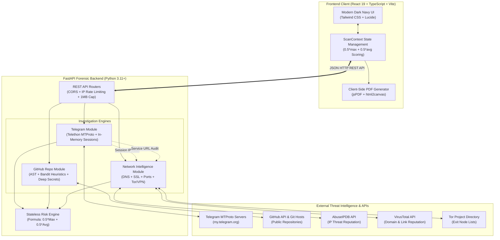

# Account Breach Investigation (ABI)

> **Tagline:** *"Find out if you were hacked, and how."*

An agentic, multi-vector cybersecurity investigation web platform engineered specifically for everyday, non-technical users. It provides plain-English forensics into connected online accounts, detects unauthorized foreign logins, flags leaked credentials in public repositories, uncovers malicious network infrastructure, and synthesizes an executive recovery action plan.

---

## 📸 Platform Overview & Visual Previews

| View | Purpose |
| :--- | :--- |
| **Active Dashboard** | High-level threat gauge, per-module risk cards, interactive donut and bar breakdowns, and recent scan logs. |
| **Telegram Forensics** | Zero-storage MTProto session audit checking for foreign sessions, impossible travel, 2FA gaps, and service alerts. |
| **Repository Forensics**| Public GitHub scanning detecting hardcoded API secrets, vulnerable dependencies, and insecure network endpoints. |
| **Network & Web Check** | IP geolocation & Tor/VPN detection, redirect hop analysis, SSL validation, port audits, and security headers. |
| **Incident Dossier**   | Multi-vector risk report with plain-English attack reconstruction, prioritized recovery checklist, and PDF export. |

---

## 🏛 System Architecture

The monorepo separates the Vite + React client from the FastAPI forensics backend. All modules feed into a centralized risk engine that outputs standardized incident dossiers.



---

## 📂 Repository Structure

```text
ABI_Investigation/
├── frontend/                     # Modern React + TypeScript SPA
│   ├── src/
│   │   ├── components/           # UI widgets (RiskGauge, StatCard, SessionTable, Stepper)
│   │   ├── context/              # Centralized scan state (ScanContext.tsx)
│   │   ├── lib/                  # API client (api.ts) & TypeScript interfaces (types.ts)
│   │   ├── pages/                # Dashboard, LinkTelegram, RepoCheck, NetworkCheck, Report
│   │   ├── App.tsx               # Route definitions
│   │   └── main.tsx              # React mounting root
│   ├── package.json              # Client dependencies
│   └── vite.config.ts            # Vite configuration
├── backend/                      # Python FastAPI Forensics Backend
│   ├── config.py                 # Pydantic BaseSettings & rate limits
│   ├── main.py                   # FastAPI application & router assembly
│   ├── models.py                 # Pydantic v2 schemas
│   ├── modules/
│   │   ├── network_module.py     # DNS, WHOIS, SSL, port probing, Tor/VPN heuristics
│   │   ├── repo_module.py        # Git cloning, secret entropy, AST scanning
│   │   ├── telegram_module.py    # Telethon MTProto read-only forensic auditor
│   │   └── risk_engine.py        # Composite scoring & attack narrative reconstruction
│   ├── routers/
│   │   ├── network.py            # /api/network/ip, /link, /website
│   │   ├── repo.py               # /api/repo/scan
│   │   ├── telegram.py           # /api/telegram/send-code, /verify, /analyze, /cancel
│   │   ├── report.py             # /api/report/generate
│   │   └── status.py             # /api/status (system integrations check)
│   ├── tests/                    # Comprehensive unit tests (78 tests passing)
│   │   ├── test_network.py
│   │   ├── test_repo.py
│   │   ├── test_telegram.py
│   │   ├── test_report.py
│   │   ├── test_status.py
│   │   └── test_real_verification.py
│   ├── requirements.txt          # Python dependencies
│   └── .env.example              # Environment variables template
├── docs/
│   └── VIVA_NOTES.md             # Project viva guide, networking concepts, & 15 Q&As
├── .gitignore                    # Root repository ignore rules
└── README.md                     # Project documentation
```

---

## ⚡ Quickstart Guide

### 1. Prerequisites
- **Node.js**: v18+ and `npm`
- **Python**: 3.11+ and `pip`
- **Git**: Installed and on system PATH

---

### 2. Backend Setup (`backend/`)

```bash
# 1. Navigate to backend directory
cd backend

# 2. Create and activate a Python virtual environment
python -m venv .venv

# On Windows (PowerShell):
.\.venv\Scripts\Activate.ps1
# On Linux/macOS:
source .venv/bin/activate

# 3. Install dependencies
python -m pip install --upgrade pip
python -m pip install -r requirements.txt

# 4. Create your local .env configuration (optional, see API keys below)
copy .env.example .env     # On Windows
cp .env.example .env       # On Linux/macOS

# 5. Start the FastAPI development server with auto-reload
python -m uvicorn main:app --port 8000 --reload
```

The backend API will be available at:
- API Base: `http://localhost:8000`
- Interactive Swagger UI: `http://localhost:8000/docs`
- ReDoc Documentation: `http://localhost:8000/redoc`

---

### 3. Frontend Setup (`frontend/`)

Open a second terminal window:

```bash
# 1. Navigate to frontend directory
cd frontend

# 2. Install dependencies
npm install

# 3. Start Vite development server
npm run dev -- --port 5173
```

Open your browser at `http://localhost:5173`.

---

## 🌐 Real Data Mode & System Status

The platform runs in **Real Data Mode** by default:
- **Zero Mock Fallbacks**: Input forms (IPs, links, domains, repos, phone numbers) do not pre-fill dummy values or substitute mock results on errors. If an integration or backend is unavailable, plain-English setup instructions and error banners guide the user.
- **In-Memory Client State**: Scan findings are held strictly in React memory (`ScanContext`) during active browser navigation. No scan results, phone numbers, or credentials are saved in `localStorage`.
- **"Clear All Data"**: A dedicated button in the application footer resets all in-memory scan records immediately.
- **"Load Demo Data"**: Available exclusively through the explicit top-level button, marking modules as demo and excluding demo scores from the overall score.
- **Status Endpoint (`GET /api/status`)**: Checks integration readiness on startup (`telegram`, `gitInstalled`, `githubToken`, `abuseipdb`, `virustotal`, `banditAvailable`) and dynamically adjusts the Navbar Data Mode badge (`Live data`, `Setup needed`, or `Demo data`).

---

## 🔑 Environment Configuration & API Keys

For full real forensics, configure the following in `backend/.env`:

| Key Name | Provider | Free Tier URL | What It Enables |
| :--- | :--- | :--- | :--- |
| `TELEGRAM_API_ID` & `TELEGRAM_API_HASH` | Telegram | [my.telegram.org](https://my.telegram.org) | **Required for Telegram**: Enables real MTProto authentication and active session queries |
| `ABUSEIPDB_KEY` | AbuseIPDB | [abuseipdb.com/register](https://www.abuseipdb.com/register) | *Optional, improves accuracy*: Live crowd-sourced IP abuse reports |
| `VIRUSTOTAL_KEY` | VirusTotal | [virustotal.com/gui/join-us](https://www.virustotal.com/gui/join-us) | *Optional, improves accuracy*: Domain & link malware threat reputation |
| `GITHUB_TOKEN` | GitHub | [github.com/settings/tokens](https://github.com/settings/tokens) | *Optional, improves rate limits*: Increases GitHub API rate limits from 60 to 5,000 reqs/hr |
| `git` CLI | Git SCM | [git-scm.com](https://git-scm.com) | **Required for Repo Check**: Clones public Git repositories |

---

## 🛡 Security & Privacy Architecture

The platform was built with defensive cybersecurity principles:

1. **Strict Zero-Storage Policy**:
   - The backend is **completely stateless**.
   - No phone numbers, passwords, OTPs, session strings, source code files, or user chats are ever written to disk or database.
   - Authentication clients utilize Telethon `StringSession` kept strictly in volatile RAM.
   - Upon completion of `/api/telegram/analyze` (inside a mandatory `finally` block), `await client.log_out()` is executed, the socket is disconnected, and the in-memory flow is deleted.

2. **Server-Side Request Forgery (SSRF) Protection**:
   - All network and link inspections validate IP addresses against reserved and dangerous ranges.
   - Blocks: `127.0.0.0/8`, `10.0.0.0/8`, `172.16.0.0/12`, `192.168.0.0/16`, `169.254.0.0/16`, loopback IPv6 (`::1`), multicast, and carrier-grade NAT (`100.64.0.0/10`).
   - Redirect chains are re-evaluated on **every single hop** (up to 8 hops) to prevent redirect-based SSRF.

3. **Safe Static Code Analysis**:
   - The repository checker clones only public repositories up to depth 1 (`--depth 1 --single-branch`).
   - It **never executes** scanned code, builds, or scripts.
   - Cloned files are cleaned up in an asynchronous `finally` block using temporary directories.
   - Payload caps: maximum repository size of 100 MB, maximum 3,000 files, individual file limit of 1 MB.

4. **Telegram Privacy Sandbox**:
   - Only reads active authorizations (`GetAuthorizationsRequest`), 2FA status (`GetPasswordRequest`), and notifications from user ID `777000` (Telegram Service Notifications).
   - **Never reads private messages, group chats, contacts, or media.**

5. **Rate Limiting & Payload Caps**:
   - `/api/telegram/send-code`: 3 requests per 10 minutes per client IP.
   - General endpoints: 10 to 20 requests per minute per client IP.
   - `/api/report/generate`: Strict 1 MB request body limit (returns `413 Payload Too Large`).

---

## 📊 Composite Risk Scoring Methodology

The overall risk score is calculated via a weighted composite formula designed to prevent dangerous alerts from being diluted:

$$\text{Overall Score} = \text{round}\Big(0.5 \times \max(\text{Scores}) + 0.5 \times \text{mean}(\text{Scores})\Big)$$

### Risk Level Thresholds:
- **Low Risk**: `0 - 24%`
- **Medium Risk**: `25 - 49%`
- **High Risk**: `50 - 74%`
- **Critical Risk**: `75 - 100%`

> [!IMPORTANT]
> **Critical Override Rule:** If any individual finding across any scanned module is classified as **Critical** (e.g. an active Tor session, physically impossible travel, or exposed AWS keys), the overall threat level is automatically elevated to at least **High**, regardless of how many safe checks were performed.

---

## 🧪 Testing & Verification

The backend includes a comprehensive pytest suite with 100% mocked external calls (zero live MTProto traffic or network calls during test runs):

```bash
cd backend
.\.venv\Scripts\python.exe -m pytest
```

Test coverage:
- **`tests/test_network.py`**: 25 tests (SSRF blocking, IP geolocations, SSL parsing, DNS apex domain extraction, redirect hops, website ports).
- **`tests/test_repo.py`**: 15 tests (URL validation, credential regexes, dependency checks, bandit heuristics, timeout handling).
- **`tests/test_telegram.py`**: 18 tests (E.164 phone formats, unconfigured 503 fallback, 2FA password prompt, FloodWait 429, dormant session detection, impossible travel, logout in finally).
- **`tests/test_report.py`**: 10 tests (missing modules, score formula, critical override, de-duplication, demo flags, 1 MB payload cap, rate limiting).

**Total: 68 / 68 Tests Passing (100%)**

---

## ⚖️ Legal & Ethical Disclaimer

> [!CAUTION]
> **Authorized Use Only:** This software is intended solely for educational, forensic, and defensive cybersecurity auditing of accounts, domains, and repositories that you personally own or have explicit authorization to inspect. Do not use this tool to probe, scan, or access accounts, servers, or repositories without permission.
>
> **Notice:** Reports generated by this software represent automated risk estimates based on heuristic indicators, not definitive or legal proof of a criminal breach.
