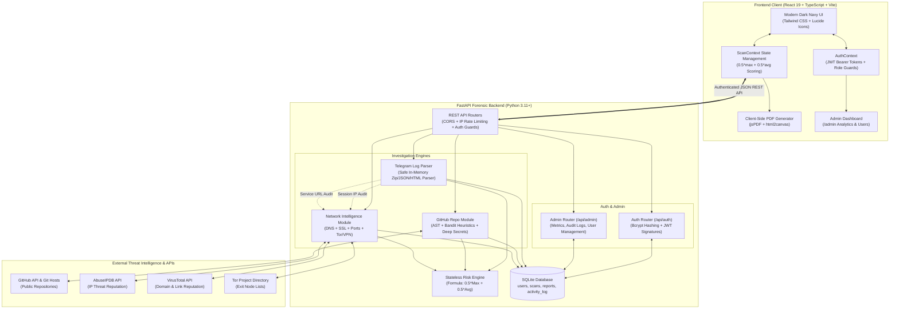

# Account Breach Investigation (ABI)

> **Tagline:** *"Find out if you were hacked, and how."*

An agentic, multi-vector cybersecurity investigation web platform engineered specifically for everyday, non-technical users. It provides plain-English forensics into connected online accounts, detects unauthorized foreign logins, flags leaked credentials in public repositories, uncovers malicious network infrastructure, and synthesizes an executive recovery action plan.

---

## 📸 Platform Overview & Visual Previews

| View | Purpose |
| :--- | :--- |
| **Active Dashboard** | High-level threat gauge, per-module risk cards, interactive donut and bar breakdowns, and recent scan history. |
| **Telegram Forensics** | Forensic analysis of user-uploaded Telegram Desktop data exports (`sessions.json`/HTML, official service notifications), detecting unauthorized devices, impossible travel, Tor/VPN IPs, rapid login spikes, and dormant sessions with zero Telegram API keys required. |
| **Repository Forensics**| Public GitHub scanning detecting hardcoded API secrets, vulnerable dependencies, and insecure network endpoints. |
| **Network & Web Check** | IP geolocation & Tor/VPN detection, redirect hop analysis, SSL validation, port audits, and security headers. |
| **Incident Dossier**   | Multi-vector risk report with plain-English attack reconstruction, prioritized recovery checklist, and PDF export. |
| **Admin Dashboard**    | Role-gated management portal (`/admin`) with platform analytics, user accounts management, audit trails, and CSV reporting. |

---

## 🏛 System Architecture

The monorepo separates the Vite + React client from the FastAPI forensics backend. All modules feed into a centralized risk engine that outputs standardized incident dossiers. User accounts, audit activities, and sanitized scans are persisted in an SQLite database.



---

## 📂 Repository Structure

```text
ABI_Investigation/
├── frontend/                     # Modern React + TypeScript SPA
│   ├── src/
│   │   ├── components/           # UI widgets (Navbar, Footer, ProtectedRoute, RiskGauge, StatCard)
│   │   ├── context/              # Centralized states (AuthContext.tsx, ScanContext.tsx)
│   │   ├── lib/                  # API client (api.ts) & TypeScript interfaces (types.ts)
│   │   ├── pages/                # Login, Register, Privacy, Dashboard, LinkTelegram, RepoCheck, NetworkCheck, Report, AdminDashboard
│   │   ├── App.tsx               # Route definitions & protected route guards
│   │   └── main.tsx              # React mounting root
│   ├── package.json              # Client dependencies
│   └── vite.config.ts            # Vite configuration
├── backend/                      # Python FastAPI Forensics Backend
│   ├── config.py                 # Pydantic BaseSettings, JWT config & rate limits
│   ├── database.py               # SQLAlchemy engine, session maker, & pure-Python initialization
│   ├── db_models.py              # SQLite schemas: User, Scan, Report, ActivityLog
│   ├── main.py                   # FastAPI application, lifespan startup, & router assembly
│   ├── models.py                 # Pydantic v2 schemas
│   ├── modules/
│   │   ├── auth_module.py        # Bcrypt password hashing, JWT creation/validation, RBAC, audit logging
│   │   ├── network_module.py     # DNS, WHOIS, SSL, port probing, Tor/VPN heuristics
│   │   ├── repo_module.py        # Git cloning, secret entropy, AST scanning
│   │   ├── telegram_log_parser.py# Safe in-memory zip/JSON/HTML forensic log parser
│   │   └── risk_engine.py        # Composite scoring & attack narrative reconstruction
│   ├── routers/
│   │   ├── auth.py               # /api/auth/register, /login, /me, /logout, DELETE /me
│   │   ├── admin.py              # /api/admin/overview, /users, /users/{id}, /activity, /export/users.csv
│   │   ├── network.py            # /api/network/ip, /link, /website
│   │   ├── repo.py               # /api/repo/scan
│   │   ├── telegram.py           # /api/telegram/logs/analyze
│   │   └── report.py             # /api/report/generate, /log-download
│   ├── tests/                    # Comprehensive unit tests (76 tests passing)
│   │   ├── conftest.py           # Test DB initialization & auth fixtures
│   │   ├── test_auth_admin.py    # Authentication, RBAC, admin controls, DB hygiene tests
│   │   ├── test_telegram_logs.py # Log parser, zip bomb protection, redaction tests
│   │   ├── test_network.py       # SSRF, DNS, SSL, ports, Tor checks
│   │   ├── test_repo.py          # Repository analysis & secret scanning
│   │   ├── test_report.py        # Report synthesis & 1 MB payload limits
│   │   ├── test_status.py        # System health status tests
│   │   └── test_real_verification.py
│   ├── requirements.txt          # Python dependencies
│   └── .env.example              # Environment variables template
├── docs/
│   └── VIVA_NOTES.md             # Project viva guide, networking concepts, & examiner Q&As
├── .gitignore                    # Monorepo git ignore rules
└── README.md                     # Project documentation
```

---

## ⚡ Quickstart Guide

### 1. Prerequisites
- **Node.js**: v18+ and `npm`
- **Python**: 3.11+ and `pip`
- **Git**: Installed and on system PATH

---

### 2. Backend Setup (`backend/`)

```bash
# 1. Navigate to backend directory
cd backend

# 2. Create and activate a Python virtual environment
python -m venv .venv

# On Windows (PowerShell):
.\.venv\Scripts\Activate.ps1
# On Linux/macOS:
source .venv/bin/activate

# 3. Install dependencies
python -m pip install --upgrade pip
python -m pip install -r requirements.txt

# 4. Create your local .env configuration
copy .env.example .env     # On Windows
# or: cp .env.example .env # On Linux/macOS

# 5. Start the FastAPI development server with auto-reload
python -m uvicorn main:app --port 8000 --reload
```

On initial startup, the backend automatically initializes the SQLite database (`app.db`) and seeds the initial admin account based on `ADMIN_EMAIL` and `ADMIN_PASSWORD` in your `.env`.

The backend API will be available at:
- API Base: `http://localhost:8000`
- Interactive Swagger UI: `http://localhost:8000/docs`
- ReDoc Documentation: `http://localhost:8000/redoc`

---

### 3. Frontend Setup (`frontend/`)

Open a second terminal window:

```bash
# 1. Navigate to frontend directory
cd frontend

# 2. Install dependencies
npm install

# 3. Start Vite development server
npm run dev -- --port 5173
```

Open your browser at `http://localhost:5173`.
- Register a new account or log in with the admin credentials configured in `backend/.env` (default: `admin@investigation.local` / `AdminSecretPass123!`).
- Access the Admin Dashboard via the profile dropdown or `/admin`.

---

## 🌐 Real Data Mode & Log Forensics

The platform runs in **Real Data Mode** by default:
- **Zero Mock Fallbacks**: Input forms (IPs, links, domains, repos) do not pre-fill dummy values or substitute mock results on errors. If an integration or backend is unavailable, plain-English error messages guide the user.
- **Telegram Log Analysis**: Users export their account data directly using Telegram Desktop (*Settings > Advanced > Export Telegram data* selecting "Active sessions" and "Telegram Service Notifications"). No Telegram API credentials or live phone verification are required.
- **In-Memory Client State**: Scan findings are held strictly in React memory (`ScanContext`) during active browser navigation.
- **"Clear All Data"**: A dedicated button in the application footer resets all in-memory scan records immediately.
- **"Load Demo Data"**: Available exclusively through the explicit top-level button, marking modules as demo and excluding demo scores from the overall score.

---

## 🔑 Environment Configuration & API Keys

Configure the following in `backend/.env`:

| Key Name | Default / Example | Purpose |
| :--- | :--- | :--- |
| `JWT_SECRET` | *(64-char random hex)* | **Required**: Secret used to sign and verify user authentication tokens. |
| `ADMIN_EMAIL` | `admin@investigation.local` | **Required**: Email for the seeded administrator account. |
| `ADMIN_PASSWORD` | `AdminSecretPass123!` | **Required**: Initial password for the seeded administrator account. |
| `DATABASE_URL` | `sqlite:///./app.db` | SQLite database connection string. |
| `ABUSEIPDB_KEY` | *(empty / optional)* | *Optional, improves accuracy*: Live crowd-sourced IP abuse reports from [abuseipdb.com](https://www.abuseipdb.com). |
| `VIRUSTOTAL_KEY` | *(empty / optional)* | *Optional, improves accuracy*: Domain & link malware threat reputation from [virustotal.com](https://www.virustotal.com). |
| `GITHUB_TOKEN` | *(empty / optional)* | *Optional, improves rate limits*: Increases GitHub API rate limits from 60 to 5,000 reqs/hr. |
| `git` CLI | On system PATH | **Required for Repo Check**: Clones public Git repositories. Checked on-demand during repository scans. |

> [!NOTE]
> No Telegram API keys (`TELEGRAM_API_ID` or `TELEGRAM_API_HASH`) are required. Telegram audits are performed purely through user-uploaded forensic log exports.

---

## 🛡 Security & Privacy Architecture

The platform was built with defensive cybersecurity principles:

1. **Strict In-Memory Log Processing & OTP Redaction**:
   - Uploaded Telegram export files (`.zip`, `.json`, `.html`, `.txt`) are parsed exclusively in volatile memory (`io.BytesIO`) and destroyed immediately in a `finally` block.
   - Raw files and raw message text are **never saved to disk or written to the database**.
   - All OTPs, login codes, and numeric verification sequences in messages are **immediately redacted** (`\b\d{4,8}\b` -> `****`) upon parsing.
   - Non-service personal chat files are completely ignored and discarded.

2. **Safe ZIP Archive Handling**:
   - Defends against Zip Slip / path traversal attacks by validating resolved member paths against the destination target.
   - Rejects nested zip archives.
   - Enforces a 200-entry limit and 50 MB total uncompressed size limit to prevent decompression bombs (Zip Bombs).
   - Maximum upload size of 10 MB per file, 25 MB total.

3. **Authentication, RBAC & Audit Trails**:
   - Passwords hashed using `bcrypt`.
   - Stateless JWT tokens signed with HMAC-SHA256 (`HS256`).
   - Strict Role-Based Access Control: Admin endpoints require `role == "admin"`.
   - Comprehensive audit logging (`activity_log` table) recording security events (`register`, `login`, `upload_logs`, `scan_repo`, `scan_network`, `generate_report`, `download_pdf`, `delete_account`, `admin_viewed_user`).
   - Users can permanently delete their own account and all associated scan history with one click.

4. **Server-Side Request Forgery (SSRF) Protection**:
   - All network and link inspections validate IP addresses against reserved and dangerous ranges.
   - Blocks: `127.0.0.0/8`, `10.0.0.0/8`, `172.16.0.0/12`, `192.168.0.0/16`, `169.254.0.0/16`, loopback IPv6 (`::1`), multicast, and carrier-grade NAT (`100.64.0.0/10`).
   - Redirect chains are re-evaluated on **every single hop** (up to 8 hops) to prevent redirect-based SSRF.

5. **Safe Static Code Analysis**:
   - The repository checker clones only public repositories up to depth 1 (`--depth 1 --single-branch`).
   - It **never executes** scanned code, builds, or scripts.
   - Cloned files are cleaned up in an asynchronous `finally` block using temporary directories.
   - Payload caps: maximum repository size of 100 MB, maximum 3,000 files, individual file limit of 1 MB.

6. **Rate Limiting & Payload Caps**:
   - Login endpoint: 5 requests per minute per client IP.
   - General scan endpoints: 10 to 20 requests per minute per client IP.
   - `/api/report/generate`: Strict 1 MB request body limit (returns `413 Payload Too Large`).

---

## 📊 Composite Risk Scoring Methodology

The overall risk score is calculated via a weighted composite formula designed to prevent dangerous alerts from being diluted:

$$\text{Overall Score} = \text{round}\Big(0.5 \times \max(\text{Scores}) + 0.5 \times \text{mean}(\text{Scores})\Big)$$

### Risk Level Thresholds:
- **Low Risk**: `0 - 24%`
- **Medium Risk**: `25 - 49%`
- **High Risk**: `50 - 74%`
- **Critical Risk**: `75 - 100%`

> [!IMPORTANT]
> **Critical Override Rule:** If any individual finding across any scanned module is classified as **Critical** (e.g. an active Tor session, physically impossible travel, or exposed AWS keys), the overall threat level is automatically elevated to at least **High**, regardless of how many safe checks were performed.

---

## 🧪 Testing & Verification

The backend includes a comprehensive pytest suite covering log analysis, authentication, admin controls, network security, and code forensics:

```bash
cd backend
.\.venv\Scripts\python.exe -m pytest
```

Test coverage:
- **`tests/test_auth_admin.py`**: User registration, bcrypt hashing, login rate limits, self-deletion, RBAC permission barriers, admin metrics, user management, and DB sanitization.
- **`tests/test_telegram_logs.py`**: Sessions JSON/HTML extraction, service chat parsing, OTP redaction, non-service chat filtering, impossible travel heuristics, zip slip prevention, nested zip rejection, and zip bomb guards.
- **`tests/test_network.py`**: SSRF blocking, IP geolocations, SSL parsing, DNS apex domain extraction, redirect hops, website ports.
- **`tests/test_repo.py`**: URL validation, credential regexes, dependency checks, bandit heuristics, timeout handling, Git CLI detection.
- **`tests/test_report.py`**: Composite score calculations, critical override rules, demo flags, 1 MB payload caps.
- **`tests/test_status.py` & `tests/test_real_verification.py`**: Health endpoint and real integration verifications.

**Total: 76 / 76 Tests Passing (100%)**

---

## ⚖️ Legal & Ethical Disclaimer

> [!CAUTION]
> **Authorized Use Only:** This software is intended solely for educational, forensic, and defensive cybersecurity auditing of accounts, domains, and repositories that you personally own or have explicit authorization to inspect. Do not use this tool to probe, scan, or access accounts, servers, or repositories without permission.
>
> **Notice:** Reports generated by this software represent automated risk estimates based on heuristic indicators, not definitive or legal proof of a criminal breach.
